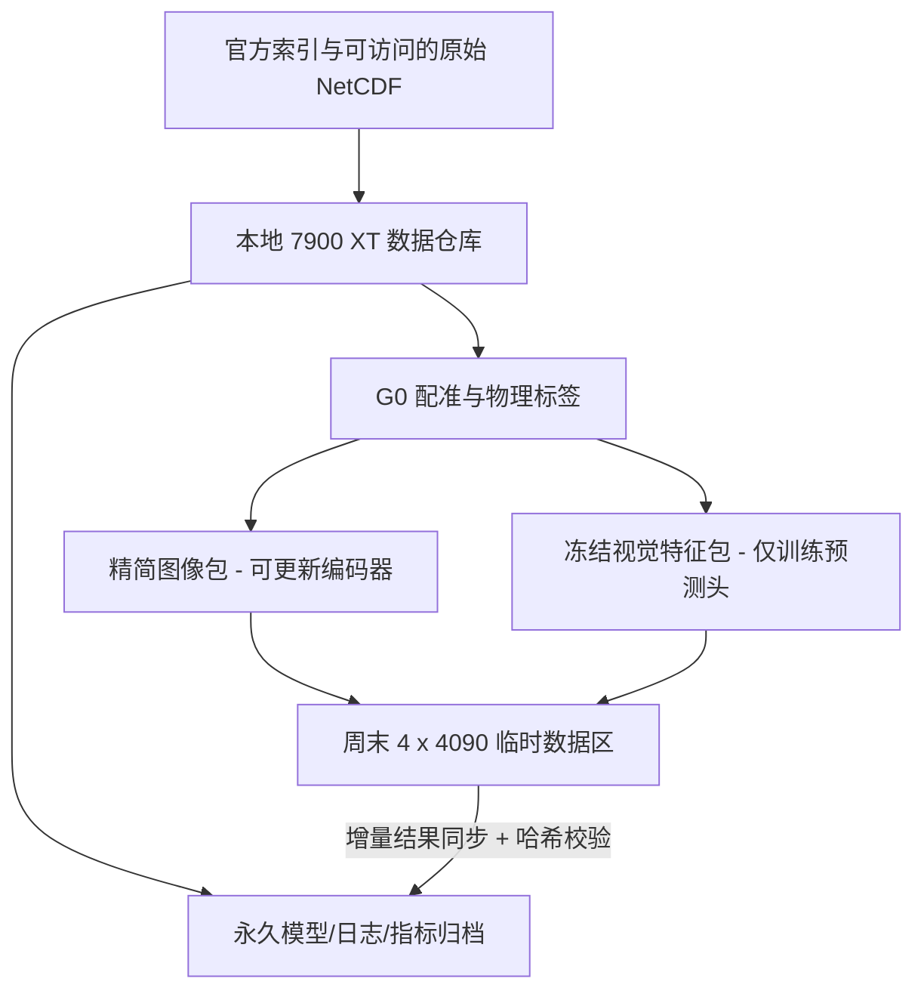
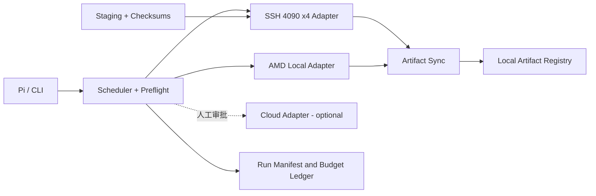

# LunarRisk 项目说明与工程实施协议

> **版本**：v0.1 · 2026-10-17  
> **项目定位**：可信月球地形风险研究 + 异构 GPU 低成本实验编排  
> **主要研究资源**：RX 7900 XT 20GB（平时可用）；同一台周末共享服务器 4×RTX 4090 24GB（个人临时存储上限按 **10 GiB 硬限制**设计）  
> **云端兜底预算**：总额不超过 **RMB 500**；默认不购买云资源  
> **本文状态**：设计与任务交接文档，**不代表数据已下载、模型已训练或远程服务器已验证**。

---

## 0. 一页摘要：现在要做什么

本项目保留 LunarJEV 的长期方向，但当前优先实施 **LunarRisk**：从轨道 NAC 光学影像、粗地形和观测几何估计不可直接观测的高分辨率地形属性，进一步对**动态工程规则**给出可校准的风险判断，在独立地理区域和光照变化下检验可靠性。

工程上采用 **local-first / weekend-burst / cloud-fallback**：

- **平时的 7900 XT**：负责下载与审计数据、物理真值生成、数学验证、冻结特征提取、轻量模型训练、运行日志和长期产物归档。
- **周末的 4×4090 服务器**：只承担有明确收益的 GPU 密集训练。以 **每张卡独立执行一个实验**为默认调度，不默认启用四卡 DDP。
- **付费 GPU 云平台**：只在本地和周末资源无法满足里程碑时启用；所有付费创建与支出必须经过显式确认。
- **10 GiB 磁盘硬上限**：4090 服务器不作为数据仓库或永久权重仓库；使用精简数据包、共享只读数据、滚动 checkpoint、执行结果及时回传。

**首要交付**不是 Qwen、Clef 或完整 LunarJEV，而是可复现的 `真实 NAC–DTM 数据清单 → 物理风险标签 → 属性预测基线 → UAR–Coverage 曲线`。

### 成功定义

1. 数据：明确实际存在且能访问的 NAC、粗 DTM、3m DTM/坡度影像，构建无空间/源数据泄漏的切分。
2. 科学：在固定真实测试区域证明（或诚实否定）联合概率地形属性相较点估计/独立分布是否改善事件级风险评估。
3. 工程：7900 XT 可独立完成开发验证；周末 4090 服务器可不超过 10 GiB 工作配额、可断点恢复、可一键归档结果。
4. 财务：项目现金 GPU 云支出始终低于 ¥500，首选免费现有硬件；GPU-hours 作为单独计算资源指标，不等同于现金花费。

---

## 1. 研究动机与已有工作边界

### 1.1 核心科学问题

单视角光学图像无法完全恢复被阴影和成像几何遮蔽的地形细节。即使得到一个“预测坡度”或“预测 DEM”，最终工程问题仍然是：**在不完整观测下，区域满足指定安全规则的概率是多少？**

形式上，令：

- `X`：推理期可见的 NAC、粗 DTM、观测几何；
- `a`：3m 地形派生的隐伏物理属性，例如危险坡度面积占比、局部去趋势粗糙度和高程起伏；
- `c`：可变化的工程任务要求；
- `R(a; c)`：由明确、可审计的规则 AST 求得的布尔安全事件。

目标是估计：

\[
P(\mathrm{Safe}\mid X,c)=\int \mathbf 1[R(a;c)=1]p(a\mid X)\,da.
\]

**研究边界**：这里是 *orbital terrain-hazard screening / preliminary landing-site assessment*，不是能够取代真实着陆任务完整飞控、安全认证的系统。

### 1.2 哪些东西不是我们要声称的首创

| 已有研究方向 | 代表工作 | 对本项目的要求 |
| --- | --- | --- |
| 月球单目/多模态地形恢复 | ELunarDTMNet；*The Moon's Many Faces* | 不以单目 DEM 恢复为独立原创贡献；应有领域强基线 |
| 月球多模态表征 | NASA-IBM Lunar Foundation Model / SomBench | 主要复用编码器，并研究缺失观测下的下游风险 |
| 随机月球高程地图 | *A Stochastic Approach to Terrain Maps for Safe Lunar Landing* | 概率建模和风险地图也已有前作，要比较研究对象及效率 |
| 缺失模态生成 | TerraMind / Thinking-in-Modalities | Latent TiM 只作可选消融 |
| 语言规则和多槽快速决策 | RSJEV、Clef、Mapika/decider、神经符号概率推理 | One-Pass 作为可验证的加速/语义扩展，不是核心方法必须依赖 |

### 1.3 预注册式假设

- **H1**：相同输入、数据切分和规则下，概率属性模型的事件 Brier/NLL、固定放行覆盖率下的危险误放行风险，优于简单点估计规则。
- **H2**：当属性误差存在真实相关性时，联合属性后验优于独立边缘后验；主要检查未见复合规则与边界样本。
- **H3**：上述收益在独立地理区域/DTM 源留出与同址多光照测试中是否仍然成立；**不预设改善或统计保证**。
- **H4（可选）**：低维地形直方图丢失空间拓扑；空间危险后验可改善最大连续可用区域等空间规则。
- **H5（最后可选）**：语言条件化 One-Pass 头较 `文本→AST→联合后验→规则积分` 是否提供可验证的精度、鲁棒性或推理成本收益。

优先级为 H1 → H2 → H3 → H4 或 H5（二选一）。

---

## 2. 实际资源与工程约束

| 节点 | 可用时间 | 硬件 | 用途 | 风险/限制 |
| --- | --- | --- | --- | --- |
| `home_7900xt` | 工作日/日常 | AMD RX 7900 XT 20GB，Ubuntu + ROCm（当前环境此前为 7.0） | 全量数据管理、预处理、冻结 LFM、轻量训练、归档 | AMD 专用算子/显存 20GB；需单独测试兼容性 |
| `lab_weekend_4090x4` | 周末，需遵守共享机器授权和空闲状态 | **同一主机** 4×RTX 4090 24GB | 四个独立种子/基线并行或少数必要 DDP | 可分配磁盘**至多 10 GiB**；可能有其他用户任务；非永久计算节点 |
| `cloud_fallback` | 仅必要时 | 型号及平台按实际库存选择 | 补跑、紧急实验、临时扩容 | RMB 500 总预算；云 GPU 短缺；停机/数据盘可能计费 |

### 2.1 核心原则

1. 以**完成一个实验的真实成本**决策，而非最低 GPU 小时单价；比较时记录 `samples/sec`、单次训练 GPU-hours、数据等待时间。
2. 单卡模型一张卡能跑时，优先**四张卡跑四个独立 Job**；避免无必要 DDP、NCCL 调试和四卡同步等待。
3. 数据版本和 Git commit 必须保持一致；ROCm 与 CUDA 环境各自维护，不直接复制 venv/优化器状态。
4. 磁盘按 `10 GiB` 全部占用硬限制设计，**不假定环境、容器镜像、临时缓存不占个人配额**；P0 先测实际 `df/du`，根据结果下调可用量。
5. 只操作用户授权路径，不删除实验室其他用户的数据或进程；发现 GPU 已被占用就跳过。

### 2.2 周末节点推荐磁盘配额（初始目标，必须按真实 `du` 更新）

| 项目 | 目标硬上限 | 备注 |
| --- | ---: | --- |
| 精简、只读训练数据包 | ≤ 2.0 GiB | 同主机四 GPU **只保存一份** |
| 模型基础权重/所需配置 | ≤ 1.5 GiB | 优先复用已有环境缓存/模型权重 |
| 当前运行 checkpoint（滚动保留） | ≤ 1.5 GiB | 每 Job 最新与上次可恢复版本；归档后清理 |
| 环境/下载缓存/临时产物 | ≤ 1.5 GiB | 具体取决于已有共享镜像/环境，无法放入则改方案 |
| 日志/指标/小产物 | ≤ 0.5 GiB | 强制轮转，指标及时回传 |
| **不可侵占安全余量** | **≥ 3.0 GiB** | 避免 Dataloader、PyTorch、临时文件写满磁盘 |
| **合计** | **10.0 GiB** | 若基础镜像已计入且超额，禁止启动大任务 |

**磁盘启动硬门槛**：`df -BG` 检测目标挂载可用空间；任务启动前预估生成文件，并要求至少 `2 GiB` 即时空闲，同时保持计划余量 `3 GiB`。若两者不满足，标记为 `BLOCKED_DISK`，不自动删除未知文件。

**模型训练限制**：若默认全量 optimizer checkpoint 超出空间，使用 LoRA/只保存可训练权重与参数元数据；这意味着恢复可能仅支持“从权重重启优化器”，必须在实验日志如实标注。优先选择确实可完整恢复的 checkpoint 方案，不盲目丢弃优化器状态。

---

## 3. 数据系统：从原始月球文件到精简训练包

### 3.1 真实数据审计（G0；原则上 0 GPU）

- 先取得 SomBench `NAC_HighRes.parquet` 等**实际可获得**的元数据，枚举真正能访问的 NAC、DTM_60M/SLOPE_60M、DTM_3M/SLOPE_3M、观测几何等资产。
- Parquet 是索引不等于原始 NetCDF 数据已全部开放；**2,400 个 Tile / 3.8GB 等历史数字仅是规划目标，非已核实下载成果**。
- 建立 `manifest.parquet`：`sample_id, parent_source_id, dtm_source_id, footprint, geometry, modality_paths, sha256, valid_fraction, split_group, pack_id`。
- 依据轨道父图、立体 DTM 源和地理区域分组切分 `train / val / cal / test`，避免空间邻接或同源重叠泄漏。
- 图像 crop 必须地理配准至原生约 3m 标签网格；不要直接用相同数组索引对应不同像元分辨率。
- 生成物理真值和确定性 AST 规则：坡度超越率、局部最小二乘平面去趋势粗糙度、5–95% 高程极差。
- 保留真实像素计数生成的原始安全真值；组成数据的零值替换只能用于建模，不可篡改阈值标签。

**G0 必需文件**：`manifest.parquet`、`splits.json`、`audit.md`、`sample_gallery.png`、`checksums.txt`、`label_test_report.json`。

### 3.2 三层数据存储



**数据包 A（RAW-TINY）**：包括已裁剪的 NAC、对应粗地形、几何、必要的 3m 标签及切分；用于需要更新 LFM 的训练。统一格式如 `shard-000.tar`/`safetensors`/`zarr`，压缩方式依吞吐基准确定。不得预设文件体积。

**数据包 B（FROZEN-FEATURES）**：本地提取 LFM 特征；用于概率头、规则头、风险校准。理论示例：`2400×64×768×2 bytes` 约 `225 MiB`（不含索引、标签）。**冻结特征不允许反向更新 LFM 编码器**，不能把这类实验称为端到端 LoRA 微调。

**数据包版本键**：`pack_id = hash(sorted sample_ids + original_asset_checksums + crop/label code commit + preprocess config + split version)`。

### 3.3 10 GiB 周末服务器数据流

1. 工作日：数据存在本地；执行预处理、哈希校验、生成精简数据包；清除原始路径中的个人敏感信息。
2. 周末前：对 `lab_weekend_4090x4` 执行 SSH 探测；只同步当前必需的一份精简包，不重复为四个 Job 复制。
3. 周末期间：从相同只读包并行读取；每个 Job 有独立 `runs/job_id`；每 N 步或 N 分钟触发本地 checkpoint。
4. 训练中与训练结束：同步指标、config、最新 checkpoint 至本地归档；传输后校验文件大小和 SHA256。
5. **只有确认远程产物已安全回传**，才可通过显式命令删除明确属于当前项目的旧 checkpoint / staging 文件。不能清理未知路径。
6. 网络中断：作业允许完成本地分段并暂停上传；磁盘压力触线则安全停止/落盘最小 checkpoint，不应继续挤满磁盘。

大数据网络传输不稳定时先完成 **FROZEN-FEATURES 任务**，只要几百 MB；需要端到端微调才评估传 RAW-TINY 或在服务器本地按需下载的可行性。

---

## 4. 模型与实验矩阵

| ID | 模型 | 是否必要 | 首选资源 |
| --- | --- | --- | --- |
| B0 | 粗 DTM + 确定性规则 | 必须 | 本地 CPU |
| B1 | LFM 冻结/LoRA → 物理属性点估计 → AST | 必须 | 本地；周末复跑 |
| B2 | LFM → 独立边缘不确定性 → 规则积分 | 必须 | 7900 XT 或周末单卡 |
| B3 | LFM → 联合条件物理后验 → QMC/AST | 必须 | 7900 XT 或周末单卡 |
| B4 | ELunarDTMNet/其他直接地形重建 → 属性 → AST | 强基线 | 能复现时周末单卡 |
| B5 | B3 + 风险阈值/接受/拒判与校准 | 必须 | 本地 CPU / 小 GPU |
| B6 | 空间概率危险图 / 连通安全区 | 可选创新 | 周末单卡 |
| B7 | 语言→AST 或 One-Pass LunarJEV 决策头 | 最后可选 | 周末单卡 |

### 4.1 统一评价

- **物理指标**：属性 MAE/RMSE、后验 NLL、置信区间表现、按地形/光照分组误差。
- **事件指标**：事件 Brier Score、NLL、reliability diagram / ECE。
- **核心安全指标**：`UAR=P(TrueHazard|AcceptedSafe)`、`HMR=P(AcceptedSafe|TrueHazard)`、`Coverage=P(AcceptedSafe)`；在固定 Coverage 下比较 UAR，并报告原始计数。
- **OOD**：地理块/DTM 源留出；光照配对测试中静态地形属性不应随太阳位置变化而改变。
- **可复现性**：每个模型记录数据版本、模型版本、Git SHA、seed、GPU 型号、驱动/ROCm/CUDA 版本、吞吐、峰值显存和耗时。

**统计单位**：站点或 DTM 源组，不把同一切片上抽取的几十条规则当成几十个独立地面样本。

---

## 5. GPUFlow：工程系统要求

### 5.1 与现有 MVP 的关系（真实状态）

仓库现有 `lunarrisk-gpuflow` MVP 已包含：

- 基于 `config.json` 的本地 AMD / SSH 周末节点定义；
- `list`、`plan`、`probe`、`run`、`status` 等基础命令；
- 可选探测与显式 `--execute --yes` 启动；
- `nohup` 持久化作业与初步状态查询；
- 基础策略单元测试。

**现有 MVP 尚未具备**：自动数据包准备与哈希校验、可靠的四 GPU 资源分配、磁盘容量保护、Checkpoint 自动回传/清理、预算累计、Slurm 适配及可靠运行结果状态协议。现阶段所有训练命令均须检查用户配置，不能把占位 `train.py` 视为已有训练实现。

### 5.2 目标架构



**模块边界（建议，不要求一步写完）**：

- `scheduler`：解析任务、GPU 显存/使用率/时间窗口约束、成本预算；不执行下载或删除。
- `providers/local_rocm.py`：只读 GPU 探测、启动本地任务。
- `providers/ssh_cuda.py`：SSH `nvidia-smi`/磁盘/CPU 探测、为 4 个 GPU 各创建互不冲突的 Job。
- `staging.py`：对照 Manifest 生成数据包、rsync 传输、哈希验证、READY marker 原子写入。
- `runner.py`：规范化任务退出码、心跳、checkpoint 标记和信号处理。
- `artifacts.py`：结果回传、sha256 对账、滚动保留与确认后清理。
- `ledger.py`：GPU-hours、墙钟时间、实际云端支出（RMB）、磁盘使用量记录。
- `providers/cloud.py`（后期）：只做库存/报价 dry-run；真实创建需二次确认与预算检查。

### 5.3 任务生命周期

`CREATED → PREFLIGHT → STAGING → READY → RUNNING → SYNCING → COMPLETED`

异常状态：`BLOCKED_DISK`, `BLOCKED_GPU_BUSY`, `BLOCKED_ACCESS`, `INTERRUPTED`, `FAILED`, `SYNC_PENDING`, `ARCHIVED`。

每个 Job 独立 `run.json`：`job_id, dataset_pack_id, git_sha, node, gpu_uuid, started_at, exit_code, local_artifacts_hash, remote_artifacts_hash, gpu_hours, cash_cost_rmb, status`。

规则：**只有 `exit_code=0` 且指标与必需权重已校验回传，才能标记为 `COMPLETED`**。PID 存在不能当作成功。

### 5.4 多卡调度策略

- 以 `nvidia-smi --query-gpu=uuid,memory.total,memory.used,utilization.gpu --format=csv,noheader,nounits` 检测每张物理卡。
- 按 GPU UUID 而非仅 `0/1/2/3` 数字 ID 记录租约；通过 `CUDA_VISIBLE_DEVICES` 将一个 Job 固定到一张卡。
- 一张卡同一时刻最多运行一个由 GPUFlow 管理的重量级实验；发现其他用户进程或显存不足即不调度。
- 后台同时运行 4 个独立 `torchrun --nproc_per_node=1` / `python train.py`；必要时支持单主机 DDP，但**不得默认多卡训练会线性加速**。
- 为每个任务设置 `soft_deadline`（周末结束前预留保存与同步窗口）和 `hard_deadline`（安全停止）；没有人工确认不得跨周末窗口继续占用。

### 5.5 预检（没有全部通过不能启动）

- SSH/授权与工作目录可写；
- 系统环境和 GPU 型号对应；
- 可用 GPU 显存与实际占用；
- 目标挂载 `df/du` 与数据包估计空间；
- 共享数据包 SHA256/版本匹配；
- 本地 checkpoint 归档目标可达；
- 任务剩余时间可完成一个保存窗口；
- 任务命令及 Git SHA 已固定；
- 云端付费任务必须有明确用户批准及价格上限。

### 5.6 CLI 预期（扩展项，不是全部已实现）

```bash
# 已有 MVP 基础命令
python gpuflow.py list
python gpuflow.py plan joint_seed42 --probe
python gpuflow.py run joint_seed42 --node lab_weekend_4090x4  # 预演

# 计划扩展的命令（目前尚未实现）
python gpuflow.py data audit --config configs/dataset.yaml
python gpuflow.py data pack --split train --profile frozen
python gpuflow.py stage --node lab_weekend_4090x4 --pack PACK_ID --dry-run
python gpuflow.py preflight --node lab_weekend_4090x4
python gpuflow.py submit-batch --file jobs/weekend.yaml --dry-run
python gpuflow.py submit-batch --file jobs/weekend.yaml --execute --yes
python gpuflow.py sync --job JOB_ID --verify
python gpuflow.py archive --job JOB_ID --confirm-synced
python gpuflow.py budget --show
```

**安全要求**：任何实际付费、实际远程删除和不确定是否会覆盖远程文件的操作都不能在 `--dry-run` 中发生。避免将 SSH 密码、API Token 写入 Git。

---

## 6. 里程碑、交付物与止损门槛

### M0 — 数据真值闭环（无需租卡）

- [ ] 实际访问数据，得到完整性审计和空间切分；
- [ ] 完成 20 个以上样本的 NAC–DTM 对齐可视化与失配例子；
- [ ] 实现坡度/粗糙度/高程属性与 AST 求值单元测试；
- [ ] 记录真实可用样本数、独立地理源组数、实际数据字节数；
- [ ] 生成 `RAW-TINY` 与 `FROZEN-FEATURES` 的 32-sample 测试包。

**No-Go**：无法访问足够独立的 3m 真值源时，不开展大模型全量训练。

### M1 — 异构环境 + 小样本 Smoke Test

- [ ] 在 7900 XT 上运行真实 200-step 属性头训练；
- [ ] 在 4090 上运行相同实验，记录 `samples/sec` 与 GPU 峰值显存；
- [ ] 验证模型权重文件跨 CUDA/ROCm 可加载、模型评估输出一致到合理浮点容差；
- [ ] 实测 4090 服务器真实磁盘可用额度；
- [ ] 完成一条 `stage → train → checkpoint → sync → verify` 闭环。

**No-Go**：10 GiB 无法容纳所需基础环境、最小数据包和一个可恢复 checkpoint 时，仅运行冻结特征实验或另选部署方式。

### M2 — B0/B1/B2/B3 核心结果

- [ ] 全部在同一数据切分下训练；
- [ ] 输出 `baseline_results.csv`、事件 reliability 图、UAR–Coverage 图；
- [ ] 按同一 Coverage 和地理组 bootstrap 比较，而非只报点估计 UAR；
- [ ] 完成正/负属性相关性、边界阈值和零频坡度桶压力测试。

**No-Go**：联合模型无稳健增益，不通过追加语言模型制造“创新”。

### M3 — 地理 OOD、强基线与可投稿性复核

- [ ] 评估独立站点/DTM 源及同址不同光照；
- [ ] 复现或诚实标注 ELunarDTMNet 类基线；
- [ ] 做一次功效分析和期刊 Scope 检查；
- [ ] 依据实测选择：一区冲刺 / 应用型二区 / 有独立贡献的短论文 / 停止。

### M4（按成绩决定）— 空间风险 or LunarJEV One-Pass

优先只挑一个：

1. 若低维地形后验在空间安全圆任务上出现有意义、可复现的失效，投入空间危险图表示；
2. 若文字规则编译在表达复杂约束时出现明确的稳定性/时延瓶颈，投入 LunarJEV One-Pass。

原则：**实验决定扩展方向，不因已有设计文档而强行训练所有模块。**

---

## 7. 现金预算与算力账本

**RMB 500 是云端支出上限，不是 GPU 使用量上限。** 本地和实验室 4090 是已有可用资源，依实际电费/授权规则记录占用但不计入云 GPU 账单。

推荐初始分配：

| 用途 | 预留金额 | 批准条件 |
| --- | ---: | --- |
| 数据/环境临时云资源 | ¥50 | 本地无法完成且有明确收益 |
| 周末服务器不可用时补训练 | ¥250 | M1 通过、可运行完整 job、确认报价与预算 |
| 必需补实验/多随机种子 | ¥150 | 主结果达到 M2/M3 门槛 |
| 余额/意外扣费缓冲 | ¥50 | 最后动用 |
| **合计** | **¥500** | **未批准时实际花费为 ¥0** |

调度器禁止根据静态宣传价自动下单；需在实际申请时核对 `quoted_hourly_price`, `disk_cost`, `remaining_cash_budget`, `estimated_gpu_hours`。

GPU-hours 计算：`单卡运行小时数 × 卡数`。四张卡并行 8h 为 32 GPU-hours，即使墙钟仅 8h。以输出论文的**独立实验数、性能与可靠性**衡量价值，不以消耗满 200 GPU-hours 为目标。

---

## 8. 建议代码仓库结构

> 以下是**目标目录规划**，不是当前已有文件清单。

```text
lunarrisk/
├── PROJECT.md                   # 本文件
├── README.md                    # 最短上手操作
├── pyproject.toml
├── configs/
│   ├── data.yaml
│   ├── local_rocm.yaml
│   ├── lab_cuda.yaml
│   ├── models/
│   └── rules/
├── src/lunarrisk/
│   ├── data/                    # manifest, georegistration, packaging
│   ├── physics/                 # slope, roughness, relief, AST evaluator
│   ├── models/                  # B0/B1/B2/B3 and future extension
│   ├── evaluation/              # event calibration, risk, OOD
│   └── experiments/             # training + checkpoint + audit hooks
├── gpuflow/                     # scheduler (existing MVP to migrate)
│   ├── scheduler.py
│   ├── staging.py
│   ├── runner.py
│   ├── artifacts.py
│   ├── ledger.py
│   └── providers/
├── scripts/
├── tests/
│   ├── test_physics.py
│   ├── test_rules.py
│   ├── test_pack.py
│   ├── test_disk_guard.py
│   ├── test_scheduler.py
│   └── test_checkpoint_sync.py
├── jobs/weekend.yaml
├── reports/                     # only metadata, metrics, plots in git
└── data/                        # .gitignore (private raw data)
```

**不要提交到 Git 的内容**：原始大体积数据、模型权重、Token、服务器地址中的秘密信息、个人敏感路径。Manifest 可使用去标识化可复现版本。

---

## 9. 第一批开发任务（可直接交给 Pi / Codex）

### Sprint 1 — 先打通周末数据/产物闭环

1. **DiskGuard**：实现远程 `df/du` 探测，默认硬上限 10 GiB/安全余量 3 GiB；危险时返回明确失败原因。需有本地 fake-SSH 单元测试。
2. **Staging**：从给定 Manifest/pack 读取文件列表，产出哈希清单；`rsync --partial` 增量同步；传完校验，使用原子 rename 标记 `READY`。不自动删除原始目录。
3. **Artifact Sync**：仅收集白名单 `config.json / run.json / metrics.* / checkpoints/*.safetensors / stdout.log`；校验成功后才能进入 `ARCHIVED`。
4. **4090 资源检查**：读取单机 4 卡显存、利用率与 UUID，禁止占用忙卡。
5. **Batch Scheduler**：支持 `jobs/weekend.yaml` 四个独立单卡 Job、互不覆盖输出目录、`dry-run` 和人工确认。
6. **失败恢复**：模拟任务中断、远程空间不足、SSH 断开、结果上传失败，保证既不丢失最后一个可恢复产物，也不误删任何文件。

**Sprint 1 验收**：在不使用真实训练模型、只用 50–100MB 模拟数据包的情况下，完成 `probe → pack → stage → 4 fake jobs → sync → checksum verify → archive`，并把失败情况和磁盘峰值写入报告。

### Sprint 2 — 接入真实 LunarRisk 数据与实验

1. SomBench manifest 审计与 NAC/3m DTM 来源核验。
2. 物理属性与 AST 标签计算单元测试。
3. AMD 环境上的 200-step 训练、冻结特征生成和 Pack v1。
4. 周末 4090 一张卡的真实 LFM 基线训练；待流程稳定再开四张。
5. 产出第一版 `baseline_results.csv` 和 `fig_risk_coverage.png`。

**Sprint 2 验收**：从真实地理测试样本得到可复现的风险曲线；每个点都可追溯至数据版本、模型权重和实验配置。

---

## 10. 待确认但不阻塞当前开发的问题

1. 10 GiB 是个人目录配额、容器 writable layer，还是整机剩余空间？**未确认前按最严苛解释实施。**
2. 4090 服务器是否已有共享 PyTorch/CUDA 环境、模型缓存？若无，10 GiB 可能无法容纳完整 CUDA venv + 原始数据 + checkpoint；先用小包和冻结特征模式。
3. 服务器 SSH 外网与远程下载策略如何？是否允许 `rsync` 和持久化进程？是否有 Slurm 之类现成调度器？遵守共享机器使用规则。
4. 本地 AMD 是否有稳定公网/内网通路到 4090？若单次传输 1GiB 都困难，优先使用小冻结特征包。
5. SomBench 真实可用 NAC/DTM 数据量、注册误差和标签空间来源尚未核实；G0 决定所有研究实验规模。
6. 实际月球数据是否允许再分发，以及各模型/代码许可证条件，须在公开 GitHub 或投稿附录前核对。

---

## 11. 相关材料与依据

- 已有本地 MVP：`lunarrisk-gpuflow/README.md`、`gpuflow.py`、`config.json`；功能状态按代码实测，不把未来命令当作已支持。
- 研究路线和数据/模型门槛：`LunarRisk_stage_gated_experiment_plan_2026-10-16.md`。
- 文献与选刊策略：`LunarRisk_Research_Survey_Findings_and_Experimental_Strategy_2026-10-16.md`。
- NASA-IBM LFM：<https://github.com/NASA-IMPACT/NASA-IBM-Lunar-Foundation-Model>
- SomBench：<https://huggingface.co/datasets/nasa-ibm-ai4science/Sombench-pretraining-data>
- ELunarDTMNet：<https://doi.org/10.1109/TGRS.2024.3501153>
- *The Moon's Many Faces*：<https://doi.org/10.1016/j.isprsjprs.2026.04.008>
- IEEE Conformal Risk Control：<https://proceedings.iclr.cc/paper_files/paper/2024/hash/f3549ef9b5ff520a7e41ff3cc306ab2b-Abstract-Conference.html>

---

## 12. 最简执行口令

> **先打通一个完整、可恢复、可核验的数据/训练闭环；再扩展到四卡；最后才决定是否动用 ¥500 云预算。**
>
> 研究优先级：**真实地形数据质量 > 公平的概率基线 > 地理 OOD 风险结果 > 新模型复杂度。**
>
> GPUFlow 优先级：**10 GiB 磁盘安全 > 结果不丢失 > 尊重共享节点 > 自动化体验。**
